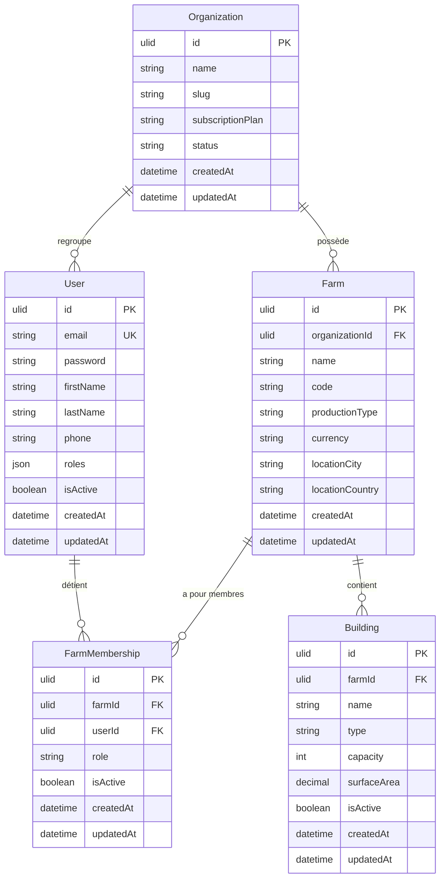

# MODÈLE DE DONNÉES — LOGICIEL DE GESTION AVICOLE

**Fichier :** `docs/DATA_MODEL.md`  
**Statut :** Référence obligatoire de modélisation  
**Version :** 1.0  
**Devise par défaut :** Franc CFA (XOF)  

---

## 1. Principes directeurs de modélisation

Conformément à [ARCHITECTURE.md](file:///c:/projets/Lefermier/docs/ARCHITECTURE.md) et [PROJECT_RULES.md](file:///c:/projets/Lefermier/docs/PROJECT_RULES.md) :

1. **Isolation stricte multi-tenants :**
   - Chaque exploitation (`Farm`) appartient à une organisation cliente (`Organization`).
   - Toutes les ressources opérationnelles (bâtiments, bandes, stocks, finances) sont impérativement rattachées à une `Farm`.
   - L'isolation est garantie côté serveur par les filtres de requêtes et les Voters de sécurité.
2. **Identifiants sécurisés (ULID) :**
   - Les clés primaires utilisent le format `Ulid` (128 bits, tri chronologique, encodage Crockford Base32).
   - Empêche l'énumération prédictive (`/api/farms/1`, `/api/farms/2`...) et prépare la synchronisation mobile hors connexion.
3. **Intégrité financière :**
   - Les montants monétaires en FCFA sont stockés en entiers (`BIGINT` ou `INT` en FCFA, pas de virgule flottante imprécise).
4. **Traçabilité et audit :**
   - Chaque entité conserve `createdAt` et `updatedAt`.
   - Les mouvements d'effectifs, d'aliments et financiers sont enregistrés sous forme d'événements/mouvements immuables plutôt que par simple écrasement de totaux.
5. **Types stricts et conventions PHP 8.4+ :**
   - Énumérations PHP typées (`BackedEnum`) pour les statuts et rôles.

---

## 2. Entités Fondations (Phase 2)

### 2.1. Organization (`organizations`)
Représente l'entité juridique, l'entreprise ou l'éleveur indépendant abonné au service.

| Champ | Type | Contraintes | Description |
|---|---|---|---|
| `id` | `ulid` | PK | Identifiant unique universel |
| `name` | `VARCHAR(150)` | NOT NULL | Nom de l'organisation ou de l'éleveur |
| `slug` | `VARCHAR(160)` | NOT NULL, UNIQUE | Identifiant textuel normalisé |
| `subscription_plan` | `VARCHAR(50)` | NOT NULL, DEFAULT 'STANDARD' | Formule d'abonnement |
| `status` | `VARCHAR(30)` | NOT NULL, DEFAULT 'ACTIVE' | `ACTIVE`, `SUSPENDED`, `TRIAL` |
| `created_at` | `DATETIME_IMMUTABLE` | NOT NULL | Date de création |
| `updated_at` | `DATETIME_IMMUTABLE` | NOT NULL | Dernière mise à jour |

### 2.2. User (`users`)
Représente un compte utilisateur authentifiable sur la plateforme.

| Champ | Type | Contraintes | Description |
|---|---|---|---|
| `id` | `ulid` | PK | Identifiant unique |
| `email` | `VARCHAR(180)` | NOT NULL, UNIQUE | Adresse email (identifiant de connexion) |
| `password` | `VARCHAR(255)` | NOT NULL | Mot de passe haché (PasswordAuthenticatedUser) |
| `first_name` | `VARCHAR(100)` | NOT NULL | Prénom |
| `last_name` | `VARCHAR(100)` | NOT NULL | Nom de famille |
| `phone` | `VARCHAR(30)` | NULL | Téléphone de contact (format international) |
| `roles` | `JSON` | NOT NULL | Rôles système globaux (`ROLE_USER`, `ROLE_ADMIN`) |
| `is_active` | `BOOLEAN` | NOT NULL, DEFAULT TRUE | Compte activé ou verrouillé |
| `created_at` | `DATETIME_IMMUTABLE` | NOT NULL | Date de création |
| `updated_at` | `DATETIME_IMMUTABLE` | NOT NULL | Dernière mise à jour |

### 2.3. Farm (`farms`)
Représente une exploitation avicole physique gérée par une organisation.

| Champ | Type | Contraintes | Description |
|---|---|---|---|
| `id` | `ulid` | PK | Identifiant unique |
| `organization_id` | `ulid` | FK (organizations.id), NOT NULL | Organisation propriétaire |
| `name` | `VARCHAR(150)` | NOT NULL | Nom de l'exploitation (ex: "Ferme Allada 1") |
| `code` | `VARCHAR(50)` | NULL | Code interne d'exploitation |
| `production_type` | `VARCHAR(30)` | NOT NULL | `BROILER` (Chair), `LAYER` (Pondeuses), `MIXED` (Mixte) |
| `currency` | `VARCHAR(3)` | NOT NULL, DEFAULT 'XOF' | Code devise ISO (FCFA = `XOF`) |
| `location_city` | `VARCHAR(100)` | NULL | Commune / ville d'implantation |
| `location_country` | `VARCHAR(2)` | NOT NULL, DEFAULT 'BJ' | Code pays ISO 3166-1 alpha-2 (`BJ` = Bénin) |
| `created_at` | `DATETIME_IMMUTABLE` | NOT NULL | Date de création |
| `updated_at` | `DATETIME_IMMUTABLE` | NOT NULL | Dernière mise à jour |

### 2.4. FarmMembership (`farm_memberships`)
Associe un utilisateur à une exploitation avec un rôle spécifique au sein de cette exploitation.

| Champ | Type | Contraintes | Description |
|---|---|---|---|
| `id` | `ulid` | PK | Identifiant unique |
| `farm_id` | `ulid` | FK (farms.id), NOT NULL | Exploitation concernée |
| `user_id` | `ulid` | FK (users.id), NOT NULL | Utilisateur concerné |
| `role` | `VARCHAR(30)` | NOT NULL | Rôle métier dans la ferme |
| `is_active` | `BOOLEAN` | NOT NULL, DEFAULT TRUE | Statut de l'accès |
| `created_at` | `DATETIME_IMMUTABLE` | NOT NULL | Date d'attribution |
| `updated_at` | `DATETIME_IMMUTABLE` | NOT NULL | Dernière mise à jour |

**Contrainte d'unicité :** `UNIQUE KEY (farm_id, user_id)`

**Énumération des rôles dans la ferme (`FarmRole`) :**
- `OWNER` : Propriétaire de l'exploitation (droits complets + gestion de l'abonnement).
- `ADMIN` : Administrateur de l'exploitation (configuration, gestion des membres).
- `MANAGER` : Gestionnaire d'exploitation (suivi opérationnel, finances, validation).
- `PRODUCTION_LEAD` : Responsable d'élevage / chef d'équipe (saisie des pontes, mortalités, soins).
- `STOCK_KEEPER` : Magasinier (gestion des stocks, réceptions, sorties d'aliments).
- `ACCOUNTANT` : Comptable (achats, ventes, rapports financiers).

### 2.5. Building (`buildings`)
Bâtiment d'élevage, poulailler ou espace dédié au sein de l'exploitation.

| Champ | Type | Contraintes | Description |
|---|---|---|---|
| `id` | `ulid` | PK | Identifiant unique |
| `farm_id` | `ulid` | FK (farms.id), NOT NULL | Exploitation de rattachement |
| `name` | `VARCHAR(100)` | NOT NULL | Nom ou numéro (ex: "Bâtiment A", "Poussinière 2") |
| `type` | `VARCHAR(30)` | NOT NULL | `POULTRY_HOUSE` (Poulailler), `BROODER` (Poussinière), `STORAGE` (Magasin) |
| `capacity` | `INT` | NOT NULL, DEFAULT 0 | Capacité maximale d'accueil en sujets |
| `surface_area` | `DECIMAL(8,2)` | NULL | Surface en m² |
| `is_active` | `BOOLEAN` | NOT NULL, DEFAULT TRUE | Bâtiment en service ou désaffecté |
| `created_at` | `DATETIME_IMMUTABLE` | NOT NULL | Date de création |
| `updated_at` | `DATETIME_IMMUTABLE` | NOT NULL | Dernière mise à jour |

---

## 3. Module Bandes & Effectifs (`Flock`, `FlockMovement`)

### 3.1. Flock (`flocks`)
Représente un lot ou une bande homogène de volailles introduite dans l'exploitation.

| Champ | Type | Contraintes | Description |
|---|---|---|---|
| `id` | `ulid` | PK | Identifiant unique |
| `farm_id` | `ulid` | FK (farms.id), NOT NULL | Exploitation de rattachement |
| `building_id` | `ulid` | FK (buildings.id), NULL, ON DELETE SET NULL | Bâtiment / poulailler d'accueil |
| `code` | `VARCHAR(50)` | NOT NULL | Code unique par exploitation (ex: "BND-2026-001") |
| `name` | `VARCHAR(100)` | NOT NULL | Libellé descriptif (ex: "Lot Cobb 500 Mars") |
| `poultry_type` | `VARCHAR(30)` | NOT NULL | `BROILER` (Chair), `LAYER` (Pondeuses), `MIXED` (Mixte), `OTHER` |
| `strain` | `VARCHAR(100)` | NULL | Souche (ex: "Cobb 500", "Ross 308", "Isa Brown", "Goliath") |
| `initial_quantity` | `INT` | NOT NULL (> 0) | Nombre de sujets introduits au démarrage |
| `current_quantity` | `INT` | NOT NULL (>= 0) | Effectif vivant actuel décompté des sorties |
| `initial_age_days` | `INT` | NOT NULL, DEFAULT 1 | Âge initial en jours à l'arrivée |
| `start_date` | `DATE_IMMUTABLE` | NOT NULL | Date d'introduction dans l'exploitation |
| `estimated_end_date` | `DATE_IMMUTABLE` | NULL | Date prévisionnelle de fin de cycle / abattage / réforme |
| `actual_end_date` | `DATE_IMMUTABLE` | NULL | Date effective de clôture de la bande |
| `status` | `VARCHAR(30)` | NOT NULL, DEFAULT 'ACTIVE' | `ACTIVE`, `COMPLETED`, `CANCELLED` |
| `notes` | `TEXT` | NULL | Remarques, provenance des poussins, couvoir, etc. |
| `created_at` | `DATETIME_IMMUTABLE` | NOT NULL | Date de création |
| `updated_at` | `DATETIME_IMMUTABLE` | NOT NULL | Dernière mise à jour |

**Contrainte d'unicité :** `UNIQUE KEY (farm_id, code)`

### 3.2. FlockMovement (`flock_movements`)
Traçabilité immuable de chaque variation d'effectif (mortalité, réforme, vente, transfert ou correction).

| Champ | Type | Contraintes | Description |
|---|---|---|---|
| `id` | `ulid` | PK | Identifiant unique |
| `flock_id` | `ulid` | FK (flocks.id), NOT NULL, ON DELETE CASCADE | Bande concernée |
| `type` | `VARCHAR(30)` | NOT NULL | `MORTALITY`, `CULLING`, `SALE`, `TRANSFER`, `ADJUSTMENT` |
| `quantity` | `INT` | NOT NULL (> 0) | Nombre de sujets concernés |
| `movement_date` | `DATE_IMMUTABLE` | NOT NULL | Date de l'opération |
| `reason` | `VARCHAR(255)` | NULL | Motif (ex: "Coccidiose suspectée", "Poids insuffisant", "Vente marché Dantokpa") |
| `recorded_by_id` | `ulid` | FK (users.id), NULL, ON DELETE SET NULL | Utilisateur ayant enregistré le mouvement |
| `created_at` | `DATETIME_IMMUTABLE` | NOT NULL | Horodatage de l'enregistrement |

---

## 4. Module Alimentation & Stocks (`InventoryItem`, `StockMovement`)

### 4.1. InventoryItem (`inventory_items`)
Représente un article stocké (aliment, vaccin, produit vétérinaire, désinfectant, matériel).

| Champ | Type | Contraintes | Description |
|---|---|---|---|
| `id` | `ulid` | PK | Identifiant unique |
| `farm_id` | `ulid` | FK (farms.id), NOT NULL, ON DELETE CASCADE | Exploitation propriétaire |
| `name` | `VARCHAR(100)` | NOT NULL | Nom de l'article (ex: "Aliment Démarrage Chair", "Vaccin Gumboro") |
| `category` | `VARCHAR(30)` | NOT NULL | `FEED`, `VACCINE`, `MEDICATION`, `DISINFECTANT`, `EQUIPMENT`, `OTHER` |
| `unit` | `VARCHAR(30)` | NOT NULL | `KG`, `G`, `BAG_50KG`, `BAG_25KG`, `TON`, `DOSE`, `VIAL`, `SACHET`, `LITER`, `ML`, `UNIT` (Voir spécification complète : `docs/UNITS_AND_MEASUREMENTS.md`) |
| `current_stock` | `DECIMAL(10,2)` | NOT NULL, DEFAULT 0.00 | Quantité physique en stock (>= 0) |
| `alert_threshold` | `DECIMAL(10,2)` | NULL | Seuil d'alerte de réapprovisionnement |
| `unit_price` | `INT` | NULL | Dernier prix ou coût unitaire moyen en FCFA |
| `notes` | `TEXT` | NULL | Description, composition ou fournisseur recommandé |
| `is_active` | `BOOLEAN` | NOT NULL, DEFAULT TRUE | Article actif ou archivé |
| `created_at` | `DATETIME_IMMUTABLE` | NOT NULL | Date de création |
| `updated_at` | `DATETIME_IMMUTABLE` | NOT NULL | Dernière mise à jour |

**Contrainte d'unicité :** `UNIQUE KEY (farm_id, name, category)`

### 4.2. StockMovement (`stock_movements`)
Traçabilité immuable de tout flux de stock entrant ou sortant.

| Champ | Type | Contraintes | Description |
|---|---|---|---|
| `id` | `ulid` | PK | Identifiant unique |
| `item_id` | `ulid` | FK (inventory_items.id), NOT NULL, ON DELETE CASCADE | Article concerné |
| `type` | `VARCHAR(30)` | NOT NULL | `INCOMING` (entrée/achat), `FEEDING` (consommation bande), `LOSS` (perte), `ADJUSTMENT` |
| `quantity` | `DECIMAL(10,2)` | NOT NULL (> 0) | Quantité mouvementée |
| `unit` | `VARCHAR(30)` | NOT NULL | Unité de mesure du mouvement |
| `unit_price` | `INT` | NULL | Prix d'achat unitaire en FCFA (pour les entrées) |
| `movement_date` | `DATE_IMMUTABLE` | NOT NULL | Date de l'opération |
| `flock_id` | `ulid` | FK (flocks.id), NULL, ON DELETE SET NULL | Bande ayant consommé l'aliment (si applicable) |
| `reason` | `VARCHAR(255)` | NULL | Motif, bon de livraison, provenderie ou justification |
| `recorded_by_id` | `ulid` | FK (users.id), NULL, ON DELETE SET NULL | Utilisateur ayant validé le mouvement |
| `created_at` | `DATETIME_IMMUTABLE` | NOT NULL | Horodatage de l'enregistrement |

---

## 5. Module Production d'Œufs (`EggProduction`)

### 5.1. EggProduction (`egg_productions`)
Enregistrement des collectes et ramassages journaliers d'œufs pour les bandes de ponte (`LAYER`, `MIXED`).
Intègre le calcul automatique des plateaux standard d'Afrique de l'Ouest (1 plateau = 30 œufs) et du taux de ponte journalier en pourcentage par rapport à l'effectif vivant.

| Champ | Type | Contraintes | Description |
|---|---|---|---|
| `id` | `ulid` | PK | Identifiant unique |
| `flock_id` | `ulid` | FK (flocks.id), NOT NULL, ON DELETE CASCADE | Bande pondeuse rattachée |
| `production_date` | `DATE_IMMUTABLE` | NOT NULL | Date du ramassage |
| `session` | `VARCHAR(20)` | NOT NULL, DEFAULT 'ALL_DAY' | Séance : `ALL_DAY`, `MORNING`, `AFTERNOON`, `EVENING` |
| `good_eggs` | `INT` | NOT NULL, DEFAULT 0 (>= 0) | Œufs normaux, propres et commercialisables |
| `cracked_eggs` | `INT` | NOT NULL, DEFAULT 0 (>= 0) | Œufs fêlés ou cassés |
| `dirty_eggs` | `INT` | NOT NULL, DEFAULT 0 (>= 0) | Œufs sales nécessitant nettoyage |
| `deformed_eggs` | `INT` | NOT NULL, DEFAULT 0 (>= 0) | Œufs anormaux, mous ou sans coquille |
| `total_eggs` | `INT` | NOT NULL (>= 0) | Total ramassé (`good + cracked + dirty + deformed`) |
| `trays_count` | `INT` | NOT NULL (>= 0) | Nombre de plateaux pleins (`intdiv(good_eggs, 30)`) |
| `loose_eggs_count` | `INT` | NOT NULL (>= 0) | Œufs hors plateau restant (`good_eggs % 30`) |
| `flock_quantity_at_date` | `INT` | NOT NULL (>= 0) | Snapshot de l'effectif vivant à la date de collecte |
| `laying_rate` | `DECIMAL(5,2)` | NOT NULL | Taux de ponte en % (`(total_eggs / flock_quantity) * 100`) |
| `notes` | `TEXT` | NULL | Remarques, conditions climatiques, anomalie de ponte |
| `recorded_by_id` | `ulid` | FK (users.id), NULL, ON DELETE SET NULL | Utilisateur ayant saisi la ponte |
| `created_at` | `DATETIME_IMMUTABLE` | NOT NULL | Date d'enregistrement |
| `updated_at` | `DATETIME_IMMUTABLE` | NOT NULL | Dernière mise à jour |

**Contrainte d'unicité :** `UNIQUE KEY uniq_flock_date_session (flock_id, production_date, session)`

**Règles de validation métier :**
- Rejet immédiat (HTTP 422 `InvalidFlockTypeForEggProductionException`) si la bande est de type `BROILER` (chair).
- Rejet immédiat (HTTP 422 `InactiveFlockEggProductionException`) si la bande n'est plus active (`COMPLETED` ou `CANCELLED`).
- Rejet immédiat (HTTP 409 `DuplicateEggProductionSessionException`) en cas de double saisie pour la même bande, la même date et la même séance.
- Recalcul automatique et dynamique des totaux, plateaux et taux de ponte à la création et à la modification (PUT).

---

## 6. Module Finances & Ventes (`Transaction`, `Contact`)

### 6.1. Contact (`contacts`)
Représente les tiers en relation commerciale avec l'exploitation (acheteurs d'œufs de table, revendeuses du marché Dantokpa, provenderies, couvoirs, grossistes).

| Champ | Type | Contraintes | Description |
|---|---|---|---|
| `id` | `ulid` | PK | Identifiant unique universel |
| `farm_id` | `ulid` | FK (farms.id), NOT NULL, ON DELETE CASCADE | Exploitation de rattachement |
| `type` | `VARCHAR(20)` | NOT NULL | `CLIENT` (Acheteur), `SUPPLIER` (Fournisseur), `BOTH` (Mixte) |
| `name` | `VARCHAR(150)` | NOT NULL | Nom ou raison sociale |
| `phone` | `VARCHAR(30)` | NULL | Numéro de téléphone / MoMo |
| `email` | `VARCHAR(180)` | NULL | Adresse email |
| `address` | `VARCHAR(255)` | NULL | Adresse géographique / repère |
| `city` | `VARCHAR(100)` | NULL | Ville ou commune (ex: Cotonou, Calavi, Allada) |
| `notes` | `TEXT` | NULL | Conditions commerciales, remises, historique |
| `is_active` | `BOOLEAN` | NOT NULL, DEFAULT TRUE | Statut actif ou archivé |
| `created_at` | `DATETIME_IMMUTABLE` | NOT NULL | Date de création |
| `updated_at` | `DATETIME_IMMUTABLE` | NOT NULL | Dernière mise à jour |

**Index :** `INDEX idx_farm_contact_type (farm_id, type)`

### 6.2. Transaction (`transactions`)
Traçabilité des flux financiers et de trésorerie en Franc CFA (`XOF`).
Permet le suivi global de la rentabilité de l'exploitation ainsi que le calcul de la marge brute par bande (`flock_id`).

| Champ | Type | Contraintes | Description |
|---|---|---|---|
| `id` | `ulid` | PK | Identifiant unique universel |
| `farm_id` | `ulid` | FK (farms.id), NOT NULL, ON DELETE CASCADE | Exploitation de rattachement |
| `type` | `VARCHAR(20)` | NOT NULL | `INCOME` (Recette/Encaissement) ou `EXPENSE` (Dépense/Décaissement) |
| `category` | `VARCHAR(40)` | NOT NULL | Catégorie comptable ventilée (voir ci-dessous) |
| `amount` | `BIGINT` | NOT NULL (> 0) | Montant intègre en Franc CFA (`XOF`) |
| `payment_method` | `VARCHAR(30)` | NOT NULL, DEFAULT 'CASH' | Mode de règlement |
| `transaction_date` | `DATE_IMMUTABLE` | NOT NULL | Date de l'opération comptable |
| `reference` | `VARCHAR(100)` | NULL | Numéro de reçu, facture, ID transaction MoMo |
| `description` | `VARCHAR(255)` | NULL | Libellé explicatif de l'opération |
| `contact_id` | `ulid` | FK (contacts.id), NULL, ON DELETE SET NULL | Tiers concerné (client ou fournisseur) |
| `flock_id` | `ulid` | FK (flocks.id), NULL, ON DELETE SET NULL | Bande rattachée pour le calcul de marge spécifique |
| `recorded_by_id` | `ulid` | FK (users.id), NULL, ON DELETE SET NULL | Utilisateur ayant enregistré l'écriture |
| `created_at` | `DATETIME_IMMUTABLE` | NOT NULL | Horodatage de création |
| `updated_at` | `DATETIME_IMMUTABLE` | NOT NULL | Dernière modification |

**Indices :**
- `INDEX idx_farm_transaction_date (farm_id, transaction_date)`
- `INDEX idx_farm_transaction_type (farm_id, type)`
- `INDEX idx_flock_transaction (flock_id)`

**Énumération des catégories (`TransactionCategory`) :**
- **Recettes (`INCOME`) :**
  - `EGG_SALE` : Vente de plateaux d'œufs de table.
  - `MEAT_POULTRY_SALE` : Vente de poulets de chair vifs ou abattus.
  - `LAYER_CULL_SALE` : Vente de poules pondeuses réformées.
  - `CHICK_SALE` : Vente de poussins ou reproducteurs.
  - `MANURE_SALE` : Vente de fientes / fumier / engrais organique.
  - `OTHER_INCOME` : Autres encaissements.
- **Dépenses (`EXPENSE`) :**
  - `FEED_PURCHASE` : Achat d'aliments complets, concentrés, maïs, tourteaux.
  - `CHICK_PURCHASE` : Achat de poussins d'un jour au couvoir.
  - `MEDICATION_VACCINE` : Vaccins, antibiotiques, vitamines.
  - `EQUIPMENT_LITTER` : Copeaux de litière, mangeoires, alvéoles.
  - `SALARY_LABOR` : Salaires et main-d'œuvre journalière.
  - `UTILITIES` : Électricité (SBEE), Eau (SONEB), carburant du groupe électrogène.
  - `TRANSPORT` : Frais de transport des intrants ou livraisons.
  - `RENT_LEASE` : Loyer des bâtiments ou bail foncier.
  - `OTHER_EXPENSE` : Autres charges courantes.

**Énumération des modes de paiement (`PaymentMethod`) :**
- `CASH` : Espèces.
- `MTN_MOMO` : MTN Mobile Money.
- `MOOV_MONEY` : Moov Money.
- `CELTIIS_CASH` : Celtiis Cash.
- `BANK_TRANSFER` : Virement bancaire.
- `CHECK` : Chèque bancaire.
- `OTHER` : Autre moyen de règlement.

---

## 7. Module Santé Animale, Vaccins & Prophylaxie (`HealthTreatment`)

### 7.1. HealthTreatment (`health_treatments`)
Représente une intervention sanitaire préventive ou curative (vaccination, déparasitage, traitement anticoccidien, cure de vitamines) planifiée ou administrée à une bande de volailles.

| Champ | Type | Contraintes | Description |
|---|---|---|---|
| `id` | `ulid` | PK | Identifiant unique universel |
| `farm_id` | `ulid` | FK (farms.id), NOT NULL, ON DELETE CASCADE | Exploitation de rattachement |
| `flock_id` | `ulid` | FK (flocks.id), NOT NULL, ON DELETE CASCADE | Bande de volailles ciblée |
| `inventory_item_id` | `ulid` | FK (inventory_items.id), NULL, ON DELETE SET NULL | Médicament / vaccin du magasin déduit |
| `recorded_by_id` | `ulid` | FK (users.id), NULL, ON DELETE SET NULL | Utilisateur ayant validé le soin |
| `title` | `VARCHAR(150)` | NOT NULL | Nom de l'intervention (ex: "Vaccin Gumboro J7") |
| `type` | `VARCHAR(30)` | NOT NULL | `VACCINATION`, `TREATMENT`, `DEWORMING`, `VITAMIN`, `DISINFECTION`, `OTHER` |
| `administration_method` | `VARCHAR(30)` | NOT NULL | `DRINKING_WATER`, `INJECTION`, `OCULAR_NASAL`, `SPRAY`, `FEED`, `TOPICAL`, `OTHER` |
| `target_age_days` | `INT` | NOT NULL | Âge théorique en jours des volailles au moment du soin |
| `scheduled_date` | `DATE_IMMUTABLE` | NOT NULL | Date prévisionnelle d'administration |
| `administered_date` | `DATE_IMMUTABLE` | NULL | Date effective de réalisation du soin |
| `status` | `VARCHAR(30)` | NOT NULL, DEFAULT 'SCHEDULED' | `SCHEDULED`, `COMPLETED`, `CANCELLED`, `MISSED` |
| `quantity_used` | `DECIMAL(10,2)` | NULL | Doses ou volume consommés (flacons, ml, g) |
| `cost_fcfa` | `INT` | NULL | Coût total engagé en FCFA |
| `veterinarian` | `VARCHAR(100)` | NULL | Nom du vétérinaire ou agent vaccinateur |
| `notes` | `TEXT` | NULL | Numéro de lot du vaccin, posologie, observations |
| `created_at` | `DATETIME_IMMUTABLE` | NOT NULL | Date de planification |
| `updated_at` | `DATETIME_IMMUTABLE` | NOT NULL | Dernière mise à jour |

**Index de performance :**
- `INDEX idx_health_farm (farm_id)`
- `INDEX idx_health_flock (flock_id)`
- `INDEX idx_health_scheduled_date (scheduled_date)`
- `INDEX idx_health_status (status)`

---

## 8. Tableau de Bord & Indicateurs KPI (`Dashboard`)

Point d'entrée analytique consolidé (`GET /api/farms/{id}/dashboard`), calculé à la volée côté serveur pour garantir une restitution instantanée sans déphasage de données.

### 7.1. Blocs de restitution

1. **Cheptel & Bandes actives (`flocks`) :**
   - `activeFlocksCount` : Nombre de bandes actives en cours d'élevage (`FlockStatus::ACTIVE`).
   - `totalBirds` : Effectif vivant total présent sur le site (décompté des mortalités, réformes et ventes).
   - `broilerBirds` : Nombre de poulets de chair vivants (`PoultryType::BROILER`).
   - `layerBirds` : Nombre de poules pondeuses vivantes (`PoultryType::LAYER`).
   - `averageMortalityRate` : Taux de perte/mortalité moyen sur les bandes actives.

2. **Production d'œufs (`eggProduction`) :**
   - `today` : Ramassage du jour (total œufs, décomposition en plateaux de 30 œufs, œufs hors plateau et taux de ponte).
   - `summary` : Synthèse cumulée sur la période (7 jours par défaut) avec ventilation des œufs normaux, fêlés, sales et déformés.
   - `chart` : Série chronologique journalière (`date`, `goodEggs`, `crackedEggs`, `totalEggs`, `traysCount`, `layingRate`) permettant de tracer les courbes de ponte sur le client frontend.

3. **Stocks & Alertes sanitaires/alimentaires (`inventory`) :**
   - `totalItemsCount` : Nombre total d'articles suivis en stock.
   - `lowStockCount` : Nombre d'articles sous le seuil d'alerte (`currentStock <= alertThreshold`).
   - `estimatedValuation` : Valeur estimée totale du stock en FCFA (`SUM(currentStock * unitPrice)`).
   - `lowStockAlerts` : Liste détaillée des articles nécessitant un réapprovisionnement d'urgence.

4. **Finances & Trésorerie (`finances`) — *Restreint selon le rôle* :**
   - Restreint aux rôles habilités (`OWNER`, `ADMIN`, `MANAGER`, `ACCOUNTANT`).
   - Si l'utilisateur a un rôle restreint (`PRODUCTION_LEAD`, `STOCK_KEEPER`), le bloc retourne `hasAccess: false` et masque toutes les données financières confidentielles.
   - `currentMonth` : Recettes (`income`), dépenses (`expense`), solde net (`netBalance`) et devise (`XOF`) du mois en cours.
   - `period` : Synthèse sur la période sélectionnée.
   - `recentTransactions` : Les 5 dernières opérations enregistrées.

---

## 8. Synthèse des Modules API Réalisés

L'ensemble du cœur de métier avicole est désormais opérationnel sur l'API Symfony 8 :
- **Authentification & Multi-Tenancy :** Inscription atomique, connexion JWT, isolation par organisation et rôles d'exploitation.
- **Exploitations & Bâtiments :** Fermes, capacités et bâtiments d'élevage.
- **Bandes & Effectifs :** Suivi des lots (chair, ponte, mixte), décompte dynamique du cheptel et mortalité.
- **Alimentation & Stocks :** Valorisation du magasin, mouvements entrants/sortants et seuils d'alerte.
- **Production d'œufs :** Calcul automatique des plateaux de 30 œufs, calibrage (normaux, fêlés, sales) et taux de ponte.
- **Finances & Ventes :** Recettes et dépenses en FCFA, modes de règlement locaux (MoMo MTN, Moov, Celtiis, etc.) et rentabilité par bande.
- **Tableau de Bord KPI :** Restitution consolidée temps réel et sécurité granulaire par profil.
- **Clés API Développeur & IoT :** Clés préfixées `lef_live_...` / `lef_test_...` pour machines, capteurs connectés et partenaires externes.

---

## 9. Clés API Développeur & Intégrations Machine (`api_keys`)

Ce module permet aux machines, automates de régulation (capteurs de température/humidité), systèmes de pesée automatique et logiciels partenaires (cabinets vétérinaires, couvoirs, comptabilité) d'interagir directement avec l'API Lefermier 24h/24 sans nécessiter de session utilisateur interactive.

### 9.1. Attributs de l'entité `ApiKey` :
- `id` : Identifiant unique ULID (26 caractères Crockford Base32).
- `farm_id` : Clé étrangère vers `farms(id)` avec cascade de suppression (isolation multi-tenant stricte).
- `created_by_id` : Clé étrangère vers `users(id)` pour traçabilité de l'émetteur.
- `name` : Libellé de l'intégration (ex: `"Capteur Poulailler A - Zinvié"`, `"Cabinet Vétérinaire du Sud"`).
- `key_prefix` : Préfixe d'environnement (`lef_live_` pour la production, `lef_test_` pour les bacs à sable).
- `last_four` : 4 derniers caractères de la clé brute pour affichage masqué (ex: `lef_live_...16bc`).
- `key_hash` : Empreinte cryptographique `SHA-256` (64 caractères hexadécimaux). **La clé secrète brute n'est jamais stockée en base de données.**
- `scopes` : Tableau JSON des permissions (ex: `["*"]`, `["flocks:read"]`, `["inventory:write"]`).
- `is_active` : Booléen d'état actif. Révocation immédiate en cas de compromission.
- `last_used_at` : Horodatage du dernier appel API tracé automatiquement en temps réel.
- `expires_at` : Date d'expiration optionnelle.
- `created_at` : Horodatage immuable de création.

### 9.2. En-têtes d'authentification acceptés :
- `X-API-KEY: lef_live_<token>` (Recommandé pour les scripts et requêtes HTTP machine-to-machine)
- `Authorization: ApiKey lef_live_<token>` (Alternative standardisée sans collision avec le format JWT `Bearer`)

---

## 10. Matrice Dynamique des Rôles & Permissions (`farm_roles`)

Pour s'adapter à une architecture multi-agences / multi-exploitations sans coder les rôles en dur, le système utilise un modèle **RBAC (Role-Based Access Control) granulaire et configurable par chaque agence**.

### 10.1. Attributs de l'entité `Role` (`farm_roles`) :
- `id` : Identifiant unique ULID (26 caractères Crockford Base32).
- `farm_id` : Clé étrangère vers `farms(id)` avec cascade de suppression (isolation stricte par agence).
- `name` : Nom lisible du rôle (ex: `"Superviseur Ponte Matin"`, `"Vétérinaire Conseil"`, `"Chef Magasinier"`).
- `code` : Code technique unique par ferme (ex: `"SUPERVISEUR_PONTE"`, `"OWNER"`, `"MANAGER"`).
- `description` : Texte explicatif facultatif.
- `permissions` : Tableau JSON des permissions système assignées à ce rôle (ex: `["egg:view", "egg:create", "flock:view"]`).
- `is_system` : Booléen (`true` pour le rôle Propriétaire `OWNER` qui possède le joker `["*"]` et est protégé contre modification/suppression).
- `created_at` / `updated_at` : Horodatages de création et modification.

### 10.2. Liaison dans `FarmMembership` (`farm_memberships`) :
- `role_id` : Clé étrangère nullable vers `farm_roles(id)` avec `ON DELETE SET NULL`.
- `hasPermission(string $permission)` : Méthode évaluant dynamiquement si le membre dispose de la permission atomique requise pour l'opération.

### 10.3. Catalogue des 22 Permissions Système :
| Module | Permission | Description |
| :--- | :--- | :--- |
| **Exploitation** | `farm:view`, `farm:edit`, `farm:delete` | Consultation et mise à jour de l'agence |
| **Bâtiments** | `building:manage` | Création et configuration des poulaillers |
| **Administration** | `role:manage`, `member:manage` | Gestion de la matrice des rôles et des membres |
| **Bandes & Volailles** | `flock:view`, `flock:create`, `flock:movement` | Cheptel, entrées, mortalités et réformes |
| **Alimentation & Stocks** | `inventory:view`, `inventory:create`, `inventory:movement`, `inventory:valuation` | Magasin, valorisation et consommations |
| **Production d'œufs** | `egg:view`, `egg:create` | Ramassage journalier, alvéoles et ponte |
| **Finances & Ventes** | `finance:view`, `finance:create`, `finance:margin` | Ventes, dépenses, règlements et marges |
| **Contacts & Tiers** | `contact:view`, `contact:create` | Clients, distributeurs et fournisseurs |
| **Tableau de Bord** | `dashboard:view`, `dashboard:financials` | Vue opérationnelle et accès aux chiffres financiers |
| **Intégrations & IoT** | `api_key:manage` | Gestion des clés API machines et automates |
